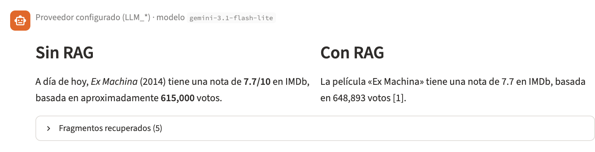
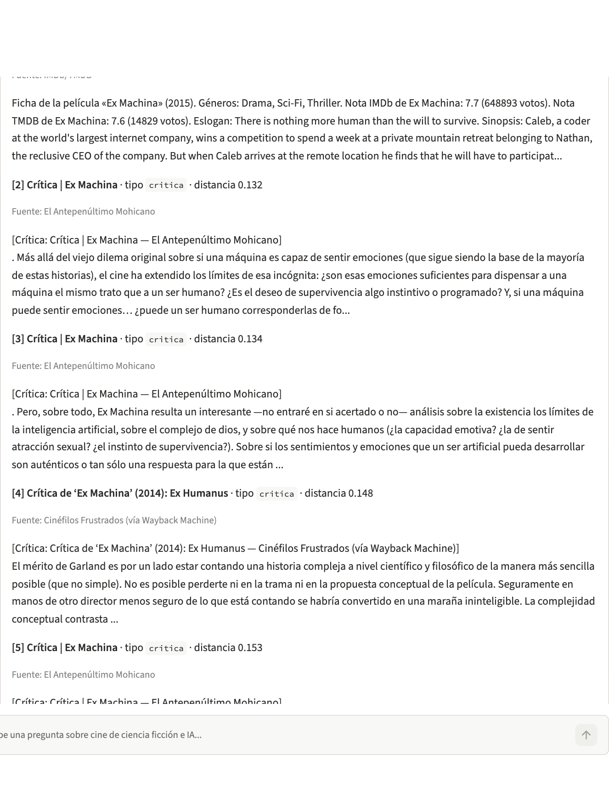
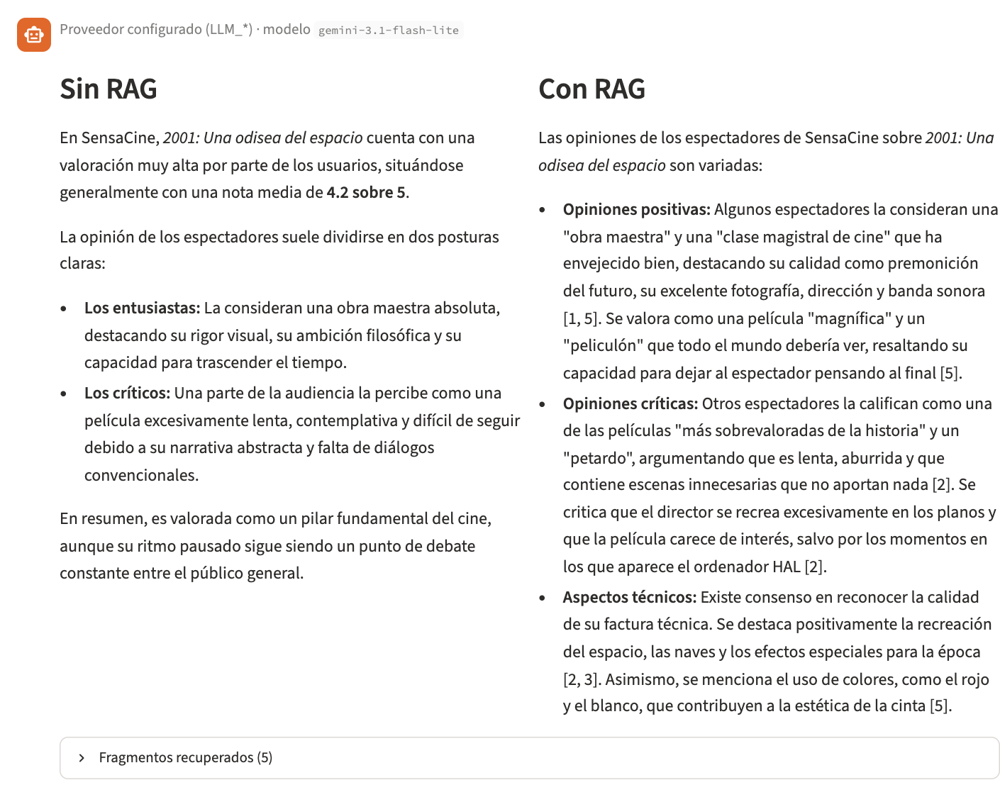
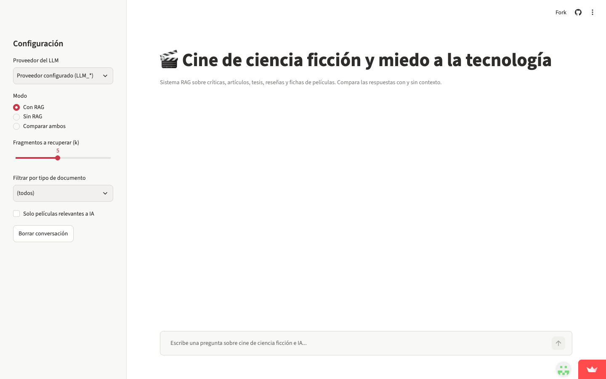

## ¿Qué hemos construido? {.smaller}

Un **sistema RAG** que responde preguntas sobre cómo el cine de ciencia ficción representa los **miedos a la tecnología**, con la **inteligencia artificial** como foco (HAL 9000, *Blade Runner*, *Ex Machina*, *Her*, *Upgrade*…).

:::: {.columns}
::: {.column width="50%"}
**Objetivo**

- Demostrar que un LLM **con** nuestra base documental responde mejor que **sin** ella.
- Menos alucinaciones, datos exactos y **fuentes citadas**.
:::
::: {.column width="50%"}
**Enlaces**

- 🚀 App: [rtdgrag.streamlit.app](https://rtdgrag.streamlit.app/)
- 💻 Código: [github.com/William-glj/RAG](https://github.com/William-glj/RAG)
- 📄 Memoria: [william-glj.github.io/RAG](https://william-glj.github.io/RAG/)
:::
::::

## Arquitectura completa

```
 IMDb · TMDB · webs · PDFs · YouTube
                 │
   cargar_datos.py + scraping_criticas.py      ← Fase A
                 │
          limpiar_datos.py  ──►  datosDescargados/limpio/
                 │
        construir_indice.py ──►  indice_chroma/  ← Fase B
        (LangChain · chunking · E5 · ChromaDB)
                 │
      ┌──────────┴──────────┐
  sin_rag.py           con_rag.py               ← Fase C
      └──────────┬──────────┘
              app.py  (Streamlit Cloud)          ← Fase D
```

| Ponente | Parte |
|---|---|
| **Guillermo** | A · Captación y pipeline de datos |
| **Tomas** | B · LangChain, ChromaDB y chunking |
| **Dylan** | D · Interfaz y despliegue |
| **Jose Ramon** | C + E · Evaluación y técnicas avanzadas |

# Fase A · Captación automatizada {background-color="#1f3b57"}

Ponente: **Guillermo**

## Fuentes: las 4 que permite el enunciado {.smaller}

| Tipo de fuente | Qué usamos | Script |
|---|---|---|
| Datasets estructurados | IMDb oficial (`title.basics`, `title.ratings`) | `cargar_datos.py` |
| API pública | TMDB v3: sinopsis, keywords, notas y **reseñas** | `cargar_datos.py` |
| Scraping web | 15 críticas y análisis (Espinof, SensaCine, Roger Ebert, CinemaNet…) | `scraping_criticas.py` |
| Documentos no estructurados | 3 PDF académicos (UACM, UCM, UOC) + 4 vídeos de YouTube transcritos | `scraping_criticas.py` |

Todo se descarga y limpia con **3 scripts en Python**, sin ningún fichero añadido a mano:

```bash
python cargar_datos.py && python scraping_criticas.py && python limpiar_datos.py
```

## Robustez de la ingesta {.smaller}

:::: {.columns}
::: {.column width="55%"}
```python
# cargar_datos.py · tmdb_get()
for intento in range(reintentos):
    r = session.get(url, params=params, timeout=30)
    if r.status_code == 200:
        time.sleep(TMDB_PAUSA)   # respeta el rate-limit
        return r.json()
    if r.status_code in (429, 500, 502, 503, 504):
        time.sleep(2 ** intento) # backoff exponencial
        continue
    r.raise_for_status()
```
:::
::: {.column width="45%"}
- **Idempotente:** si un fichero ya existe, no se vuelve a descargar.
- **Reintentos** con espera creciente ante 429 / 5xx.
- **Un extractor por web** (cada HTML es distinto) con BeautifulSoup.
- Webs que bloquean bots → copia en **Wayback Machine**.
- Limpieza: quita pies de página, portadas e índices de los PDF, reseñas < 80 caracteres y duplicados.
:::
::::

## Precisión antes que volumen

| Dato | Antes | Después |
|---|---|---|
| Películas Sci-Fi en IMDb | 16 759 | **59** con reseña de texto |
| Reseñas TMDB | 484 | **460** |
| Críticas, PDFs y vídeos | 22 | **22** (688 339 caracteres) |

Solo nos quedamos con películas que **tienen texto que el RAG pueda usar**: una ficha con solo metadatos no responde a ninguna pregunta de análisis.

# Fase B · Arquitectura RAG y chunking {background-color="#1f3b57"}

Ponente: **Tomas**

## Piezas elegidas y por qué {.smaller}

| Pieza | Elección | Motivo |
|---|---|---|
| Orquestación | **LangChain** | `Document` con metadatos, splitters y conector con Chroma listos para usar |
| Base vectorial | **ChromaDB** | Persiste en disco (sin servidor), **filtros de metadatos** nativos, ligera |
| Embeddings | **`multilingual-e5-small`** | Corpus en español **e** inglés; admite 512 tokens (MiniLM solo 128 → cortaría los fragmentos) |

```python
# rag_comun.py · los modelos E5 necesitan un prefijo distinto para cada uso
def embed_documents(self, texts):
    return self.modelo.encode(["passage: " + t for t in texts], normalize_embeddings=True)

def embed_query(self, text):
    return self.modelo.encode("query: " + text, normalize_embeddings=True)
```

## Estrategia de chunking {.smaller}

**`RecursiveCharacterTextSplitter`**: 1 500 caracteres con un solapamiento de 225 (15 %).

```python
splitter = RecursiveCharacterTextSplitter(
    chunk_size=1500, chunk_overlap=225,
    separators=["\n\n", "\n", ". ", " ", ""],   # párrafo → línea → frase → palabra
    keep_separator="end",
)
```

- Corta **primero por párrafos** y solo baja a frases o palabras si hace falta → no rompe ideas.
- Las **fichas de película no se trocean** (una ficha = un fragmento).
- Las **opiniones de SensaCine se separan por espectador** antes de trocear.
- Cada fragmento lleva una **línea de contexto**: `[Crítica: Ex Machina — Roger Ebert]`, para que el embedding sepa de qué película habla.

## ¿Qué tamaño de fragmento? Lo medimos {.smaller}

`comparar_chunking.py` reconstruye el índice con 3 tamaños y lanza las 14 preguntas de prueba:

| Tamaño | Fragmentos | Long. media | acierto@5 | MRR |
|---|---|---|---|---|
| 500 | 3 733 | 437 | **0.929** | 0.768 |
| 1 000 | 1 919 | 789 | 0.714 | 0.679 |
| **1 500** | **1 387** | **1 068** | 0.857 | **0.774** |

- **Pequeño** → búsqueda más precisa, pero cada trozo tiene poco contexto.
- **Grande** → más contexto, pero el embedding mezcla varias ideas.
- **1 500** → mejor MRR (el fragmento bueno aparece antes), trozos con más contexto e índice **2,7× más pequeño**.

# Fase C · Sin RAG vs. Con RAG {background-color="#1f3b57"}

Ponente: **Jose Ramon**

## Cómo comparamos

- Modo **"Comparar ambos"** de la app: **el mismo modelo** (`gemini-3.1-flash-lite`) responde sin contexto y con los 5 fragmentos más cercanos.
- El prompt con RAG obliga a:
  1. usar **solo** los fragmentos,
  2. **citarlos** entre corchetes `[n]`,
  3. decir *"No hay información suficiente en la base de datos"* si la respuesta no está.

Mostramos **dos pruebas** reales hechas en la app desplegada 👉

## Prueba 1 · ¿Qué nota tiene *Ex Machina* en IMDb y cuántos votos?

{fig-align="center" width="95%"}

:::: {.columns .smaller}
::: {.column width="50%"}
❌ **Sin RAG:** se inventa el número de votos (**~615 000**) y lo da como dato actual.
:::
::: {.column width="50%"}
✅ **Con RAG:** **648 893** votos, sacado de la ficha IMDb del corpus y citado como **[1]**.
:::
::::

## Prueba 1 · Lo que recuperó ChromaDB

{fig-align="center" height="520"}

El fragmento [1] es la **ficha de la película** que generó nuestro pipeline (distancia 0.119, la más cercana).

## Prueba 2 · ¿Qué opinan los espectadores de SensaCine sobre *2001*? {.smaller}

{fig-align="center" height="430"}

❌ **Sin RAG:** inventa una "nota media de **4.2 sobre 5**" y da opiniones genéricas, que valdrían para cualquier clásico. &nbsp; ✅ **Con RAG:** cita **opiniones reales** ("obra maestra", "la más sobrevalorada de la historia", "petardo") indicando el fragmento de cada una.

## Conclusión de la evaluación

| | Sin RAG | Con RAG |
|---|---|---|
| Datos concretos | Aproximados o **inventados** | **Exactos**, sacados del corpus |
| Trazabilidad | Ninguna | Citas `[n]` + fragmentos visibles |
| Fuera del corpus | Responde igual → riesgo de alucinar | *"No hay información suficiente…"* |

> Si preguntamos *"¿Cuántos Óscar ganó Oppenheimer?"*, con RAG responde que **no tiene información**: no se inventa nada.

# Fase D · Interfaz y despliegue {background-color="#1f3b57"}

Ponente: **Dylan**

## La aplicación en Streamlit

{fig-align="center" height="420"}

**Proveedor** de LLM · **Modo** (Con RAG / Sin RAG / Comparar) · **k** fragmentos · **filtro por tipo** · **solo películas de IA** · fragmentos con fuente y distancia.

## Despliegue en Streamlit Community Cloud {.smaller}

:::: {.columns}
::: {.column width="50%"}
1. Lee directamente el **repositorio de GitHub** e instala `requirements.txt`.
2. El **índice ChromaDB va versionado** (~18 MB) → no hay que reconstruirlo en la nube.
3. Las **claves de API** van en *Secrets* (TOML), nunca en el repo.
4. Modelo e índice se cargan **una sola vez** con caché.
:::
::: {.column width="50%"}
```python
# app.py: Secrets de la nube → variables de entorno
def cargar_secretos():
    for variables in VARIABLES.values():
        for clave in variables:
            if clave in st.secrets:
                os.environ[clave] = str(st.secrets[clave])

@st.cache_resource
def obtener_base():
    return abrir_base(cfg.INDICE_DIR, EmbeddingsE5())
```
:::
::::

Se descartó Hugging Face Spaces porque los Spaces Docker/Gradio requieren plan de pago para cuentas nuevas.

# Fase E · Técnicas avanzadas {background-color="#1f3b57"}

Ponente: **Jose Ramon**

## Filtros de metadatos (implementado) {.smaller}

Cada fragmento guarda `tipo` (`critica`, `resena`, `academico`, `divulgacion`, `ficha`, `opinion_espectadores`) y `relevante_ia`. **Antes** de la búsqueda semántica, Chroma filtra por ellos:

```python
# rag_comun.py
def construir_filtro(tipo=None, solo_relevantes_ia=False):
    condiciones = []
    if tipo:
        condiciones.append({"tipo": tipo})
    if solo_relevantes_ia:
        condiciones.append({"relevante_ia": True})
    if not condiciones:
        return None                      # sin filtro
    if len(condiciones) == 1:
        return condiciones[0]
    return {"$and": condiciones}
```

Ej.: *"miedo a la IA"* buscando **solo en textos académicos** o **solo en reseñas** de usuarios.

**Trabajo futuro:** reranking (FlashRank) y búsqueda híbrida BM25 + vectorial para nombres propios y cifras exactas.

## Conclusiones

- ✅ **Pipeline 100 % automatizado**: 4 tipos de fuente, limpieza y trazabilidad.
- ✅ **Chunking justificado con datos**: 1 500 caracteres elegidos midiendo acierto y MRR.
- ✅ **El RAG corrige al LLM**: datos exactos, fuentes citadas y "no lo sé" cuando no hay información.
- ✅ **App pública** en Streamlit Cloud con modo comparativo y filtros.

<br>

### ¡Gracias! ¿Preguntas?

[rtdgrag.streamlit.app](https://rtdgrag.streamlit.app/) · [github.com/William-glj/RAG](https://github.com/William-glj/RAG)
