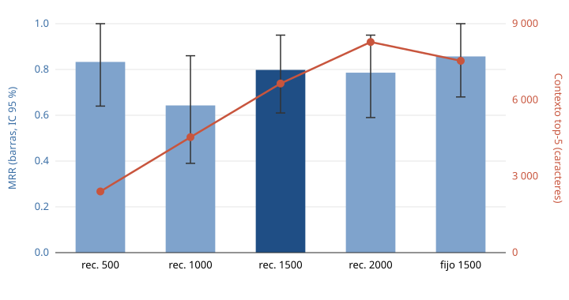
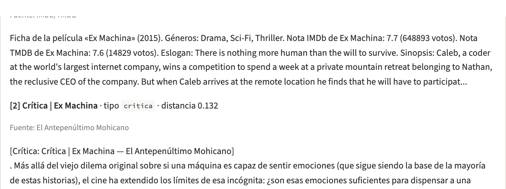
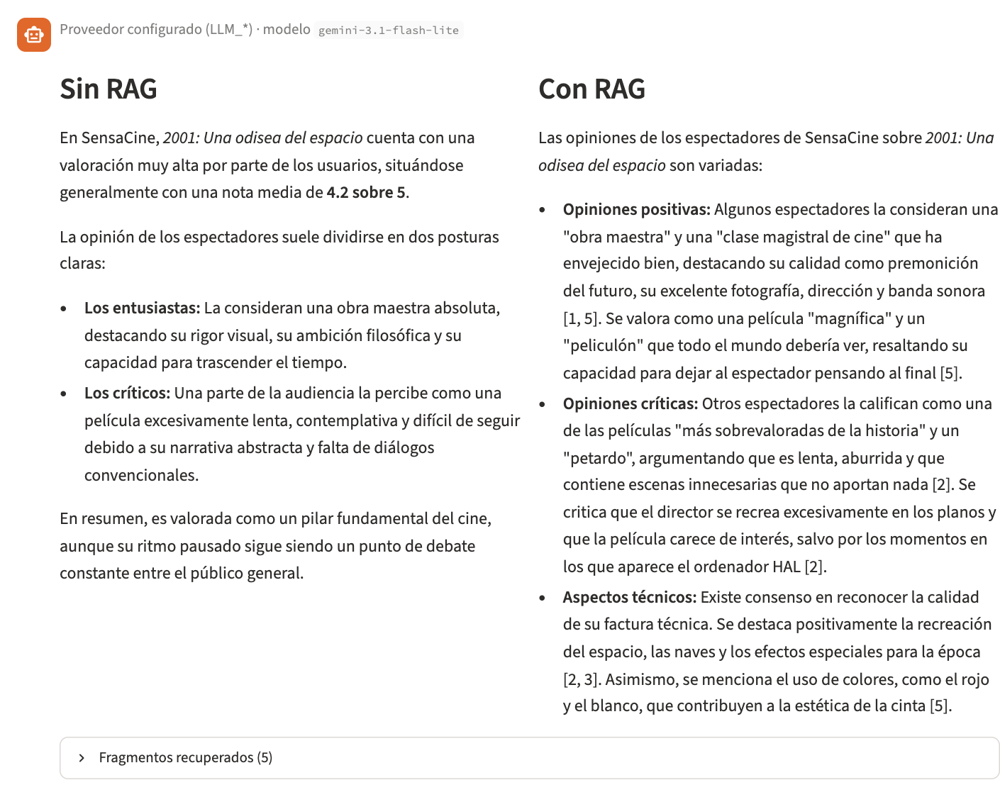
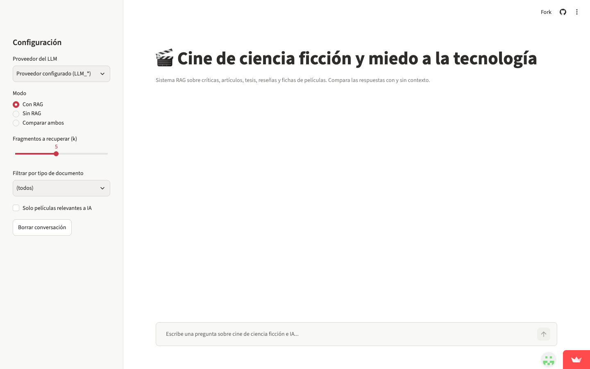

En este proyecto construimos y desplegamos un sistema RAG (*Retrieval-Augmented Generation*) sobre el **cine de ciencia ficción y los miedos a la innovación y los avances tecnológicos**, con la **inteligencia artificial** como foco concreto (HAL 9000, *Blade Runner*, *Ex Machina*, *Her*, *Upgrade*…). Siguiendo la temática de cine del primer trabajo, el objetivo es demostrar de forma empírica que un modelo de lenguaje que consulta una base documental propia responde con más precisión y menos alucinaciones que el mismo modelo sin contexto externo. El flujo de trabajo abarca desde la captación automatizada de datos (IMDb, API de TMDB, scraping de críticas, PDFs académicos y vídeos), pasando por el troceado de los textos, los embeddings y la base vectorial ChromaDB, hasta la evaluación comparativa Sin RAG vs. Con RAG y una aplicación web desplegada públicamente en Streamlit.

- **Aplicación desplegada (Streamlit):** <https://rtdgrag.streamlit.app/>
- **Repositorio GitHub:** <https://github.com/William-glj/RAG>

## 1. Fase A (Captación Automatizada de Datos (Data Pipeline))

**Justificación de la arquitectura RAG**

Mitigación de alucinaciones (Grounding): Mecanismo de control que restringe la generación del LLM únicamente a evidencia documental verificable, recuperada previamente a la síntesis de la respuesta.

Inyección de conocimiento especializado y dinámico: Incorporación de información de dominio específico y análisis recientes que suplen los vacíos o la desactualización de los pesos preentrenados del modelo base.

**Criterios de diseño del corpus documental**

Para garantizar respuestas precisas y contextualizadas sobre la tecnofobia y el impacto de la innovación, el corpus debe cumplir dos requisitos:

Enriquecido (Diversidad): Integración de múltiples fuentes (prensa, crítica cultural, literatura académica y divulgación), tipologías textuales y enfoques (éticos, críticos, alarmistas) para evitar sesgos de perspectiva.

Específico (Acotación temática): Selección estricta centrada en el miedo a la innovación y los avances tecnológicos, descartando otros subgéneros o tópicos generalistas de la ciencia ficción.

**Taxonomía del corpus implementado**

La planificación teórica se materializó en dos ejes temáticos principales:

Inteligencia Artificial y Autómatas: Representaciones de entidades autónomas y sus conflictos (Metrópolis, HAL 9000, Blade Runner, Ex Machina, Her, Terminator).

Miedos tecnológicos y evolución: Impacto social y antropológico (deshumanización industrial, complejo de Frankenstein, biotecnología y sistemas de vigilancia).

La planificación cubría **dos ramas**: la **IA** (autómatas de *Metrópolis*, HAL 9000, *Blade Runner*, *Ex Machina*, *Her*, *Terminator*…) y los **miedos y su evolución** (deshumanización industrial, complejo de Frankenstein, biotecnología, vigilancia…).

Todo el proceso está automatizado con **tres scripts de Python** que se ejecutan en orden, sin ninguna carga manual de ficheros:

| Orden | Script | Función en el pipeline |
|:--------------------------:|:---------------------|:---------------------|
| **1** | `cargar_datos.py` | Descargar los datasets de IMDb y consultar la API de TMDB. |
| **2** | `scraping_criticas.py` | Extraer críticas web, PDFs académicos y transcripciones de vídeo. |
| **3** | `limpiar_datos.py` | Limpiar y normalizar todo en `./datosDescargados/limpio`. |

: Scripts de automatización

La captación produce dos tipos de datos según su formato:

| Tipo | Procedencia |
|------------------------------------|------------------------------------|
| **Estructurados** | IMDb (datasets `title.basics.tsv.gz`, `title.ratings.tsv.gz`) y TMDB (API v3: metadatos, ratings y reseñas) |
| **No estructurados** | Críticas web, PDFs académicos y transcripciones de vídeo |

- **Estructurados:** filas × columnas con esquema fijo (título, año, géneros, nota, votos…). Cada fila es una película.
- **No estructurados:** texto libre sin esquema (crítica, artículo, tesis, transcripción), que se troceará e indexará para la recuperación.

### 1.1. `cargar_datos.py`: IMDb y API de TMDB

`cargar_datos.py` descarga y cruza las **dos fuentes estructuradas** del corpus:

- **IMDb** → datasets oficiales (`title.basics.tsv.gz` + `title.ratings.tsv.gz`): metadatos (título, año, géneros, duración) y ratings (nota media y nº de votos).
- **TMDB** → API v3: sinopsis, keywords, nota y **reseñas de usuarios**.

Ambas se enlazan por `imdb_id` en `cruceIMDBTMDB.csv`, y junto a `imdb_peliculas.csv`, `tmdb_peliculas.csv` y `tmdb_reviews.csv` forman los cuatro ficheros de salida.

**Primer filtro de especificidad (IMDb):**

``` python
# cargar_datos.py · cargar_basics()
mascara = (
    (df["titleType"] == "movie")            # solo películas
    & df["genres"].str.contains("Sci-Fi")   # género ciencia ficción
    & (df["isAdult"] == "0")                # excluye contenido adulto
)
df = df.loc[mascara]
```

De los millones de títulos de IMDb, este filtro conserva únicamente las **películas de ciencia ficción** (16 759 filas).

**Robustez de la descarga (`descargar_archivo()`):**

``` python
# cargar_datos.py · descargar_archivo()
if destino.exists():                    # idempotencia: no se re-descarga
    return destino
with requests.get(url, stream=True) as r:
    for bloque in r.iter_content(chunk_size=1024*1024):
        f.write(bloque)                 # streaming + barra de progreso tqdm
```

**Consultas a TMDB con reintentos (`tmdb_get()`):**

``` python
# cargar_datos.py · tmdb_get()
for intento in range(reintentos):
    r = session.get(url, params=params, timeout=30)
    if r.status_code == 200:
        time.sleep(TMDB_PAUSA)        # respeta el rate-limit (~4 req/s)
        return r.json()
    if r.status_code in (429, 500, 502, 503, 504) and intento < reintentos - 1:
        time.sleep(2 ** intento)      # backoff exponencial
        continue
    r.raise_for_status()
```

**Configuración de las consultas (cabecera de `cargar_datos.py`):**

``` python
# cargar_datos.py · constantes de configuración
TMDB_TERMINOS_KEYWORD = ["artificial intelligence", "robot", "android", "cyborg",
                         "technology", "cyberpunk", "dystopia"]

TERMINOS_IA = ["artificial intelligence", "a.i.", "robot", "android", "cyborg",
               "machine", "technology", "cyberpunk", "dystopia", "singularity",
               "automata", "terminator", "blade runner", "ex machina",
               "ghost in the shell", "matrix"]

PELICULAS_CANONICAS = [("2001 a space odyssey", 1968), ("metropolis", 1927),
                       ("blade runner", 1982), ("the terminator", 1984),
                       ("the matrix", 1999), ("ex machina", 2015), ...]  # 34 en total

TMDB_PAGINAS_GENERO = 5    # páginas de /discover por género (20 pelis/pág)
TMDB_PAGINAS_KEYWORD = 1   # páginas de /discover por keyword
TMDB_MAX_DETALLES = 200    # máx. películas a las que pedimos detalles
TMDB_MAX_REVIEWS = 60      # máx. películas a las que pedimos reseñas
TMDB_PAUSA = 0.28          # pausa entre peticiones (~4 req/s)
USER_AGENT = "Mozilla/5.0 ..."
```

El enunciado permite **4 tipos de fuentes**; este script cubre **2 de ellas**:

| Tipo (enunciado) | Qué usamos |
|------------------------------------|------------------------------------|
| Datasets estructurados | IMDb datasets oficiales (`title.basics.tsv.gz`, `title.ratings.tsv.gz`) |
| APIs públicas | TMDB API v3 (metadatos, sinopsis, keywords y **reseñas**) |

### 1.2. `scraping_criticas.py`: extracción web, PDFs y transcripción de vídeo

`scraping_criticas.py` lee la lista de enlaces (`TARGETS`) y, de cada página, extrae **únicamente el texto** de la crítica o artículo, guardándolo en un `.txt` con cabecera de procedencia. Genera **22 documentos de texto libre**: 15 críticas web + 3 PDF académicos (vía `TARGETS`) y 4 transcripciones de YouTube (vía `VIDEOS`).

Cada entrada de `TARGETS` es una tupla `(nombre, fuente, url, extractor)`:

``` python
# scraping_criticas.py · TARGETS  (cada fila = un documento del corpus)
("Blade Runner 2049 - la apoteosis de lo humano (CinemaNet)",
 "CinemaNet",
 "https://www.cinemanet.info/2018/01/analisis-blade-runner-2049-...",
 "cinemanet"),
```

**Un extractor por sitio** (cada web tiene un HTML distinto):

``` python
EXTRACTORES = {
    "espinof": extraer_espinof, "sensacine": extraer_sensacine,
    "lavanguardia": extraer_lavanguardia, "rogerebert": extraer_rogerebert,
    "blogspot": extraer_blogspot, "theconversation": extraer_theconversation,
    "cinemanet": extraer_cinemanet, "wordpress": extraer_wordpress,
}
```

Cada extractor localiza el contenedor del artículo con selectores CSS (`select_one`) y extrae los párrafos con BeautifulSoup. Los PDFs se procesan con `extraer_pdf()` (`pypdf`) y los vídeos con `transcribir_video()` (`yt-dlp`). Las webs que bloquean el acceso automatizado (Roger Ebert, Cinéfilos Frustrados) se leen desde su copia en la Wayback Machine.

**Robustez del scraping:**

``` python
# scraping_criticas.py · _get()  (reintentos ante 429/5xx)
for intento in range(reintentos):
    r = requests.get(url, headers=HEADERS, timeout=timeout)
    if r.status_code == 200:
        return r
    if r.status_code in (429, 500, 502, 503, 504) and intento < reintentos - 1:
        time.sleep(3 * (intento + 1))   # espera creciente
        continue
    r.raise_for_status()
```

Este script cubre las otras **2 de las 4 fuentes** del enunciado (*extracción web* y *documentos no estructurados*), más **4 transcripciones de vídeo**:

| \# | Documento | Tipo de fuente | Eje temático |
|------------------|------------------|------------------|------------------|
| 1 | *2001: Una odisea del espacio* — crítica (Espinof) | Crítica cinematográfica | IA (HAL 9000) |
| 2 | *2001* — opiniones de espectadores (SensaCine) | Opinión del público | IA |
| 3 | *2001* — tesis (Repositorio UACM, PDF) | Investigación académica | Cibernética / máquina |
| 4 | *El miedo a la tecnología, de la escritura al 5G* (La Vanguardia) | Periodismo divulgativo | Miedos históricos a la tecnología |
| 5 | *Ex Machina* — crítica (Roger Ebert) | Crítica | IA / relación humano-máquina |
| 6 | *Upgrade* — crítica (El Cuervo Enteradillo) | Crítica (blog) | IA / cuerpo aumentado |
| 7 | *IA y cine: dilemas éticos* (TFG UCM, PDF) | Investigación académica | Ética: *Metrópolis*, *2001*, *Blade Runner* |
| 8 | *El futuro de la robótica en las distopías* (The Conversation) | Prensa académica | Robótica y distopías |
| 9 | *Blade Runner* — análisis (CinemaNet) | Análisis filosófico | Replicantes / miedo a la muerte |
| 10 | *Blade Runner 2049* — análisis (CinemaNet) | Análisis filosófico | Transhumanismo / posthumanismo |
| 11 | *2001* — crítica (Cine y Psicología) | Crítica (blog) | IA (HAL 9000) |
| 12 | *Ex Machina* — crítica (El Antepenúltimo Mohicano) | Crítica (blog) | IA / relación humano-máquina |
| 13 | *Ex Machina* — crítica (Cinéfilos Frustrados) | Crítica | IA / relación humano-máquina |
| 14 | *Her* — crítica (El Antepenúltimo Mohicano) | Crítica (blog) | IA / soledad |
| 15 | *Her* — análisis académico (Repositorio UOC, PDF) | Investigación académica | Soledad posmoderna / IA |
| 16 | *Upgrade* — crítica (El Contraplano) | Crítica | IA / cuerpo aumentado |
| 17 | *Upgrade* — implantes de IA (Cinemas Comics) | Crítica | IA / implantes |
| 18 | *Blade Runner* — análisis filosófico (Proyecto Scio UCV) | Análisis filosófico | Replicantes / filosofía |
| 19 | *¿Por qué le tenemos miedo a la tecnología?* (YouTube, transcrito) | Vídeo divulgativo | Miedo a la tecnología |
| 20 | *Upgrade* — vídeo sobre implantes de IA (YouTube, transcrito) | Vídeo divulgativo | IA / implantes |
| 21 | Vídeo extra 2 — miedo a la tecnología (YouTube, transcrito) | Vídeo divulgativo | Miedo a la tecnología |
| 22 | Vídeo extra 3 — miedo a la tecnología (YouTube, transcrito) | Vídeo divulgativo | Miedo a la tecnología |

### 1.3. `limpiar_datos.py`: limpieza y normalización del corpus

`limpiar_datos.py` lee lo que generan los dos scripts anteriores y produce la versión limpia en `./datosDescargados/limpio`, aplicando **cinco reglas**: descarta nulos y duplicados, conserva **solo** las películas con texto recuperable, prioriza `relevante_ia` y limpia el texto de las críticas (pies de página, portadas, números de página).

**Segundo filtro de especificidad** (sobre el cruce IMDb↔TMDB):

``` python
# limpiar_datos.py · limpiar_csvs()
tiene_nota = cruce["rating_imdb"].notna() | cruce["rating_tmdb"].notna()
has_review = (cruce["imdb_id"].isin(review_imdb_ids)
              | cruce["imdb_id"].isin(set(scraped_count)))
conservar  = tiene_nota & has_review   # SOLO películas con reseña de texto
master     = cruce.loc[conservar]
```

**Limpieza del texto** (críticas y PDFs):

- `_BOILERPLATE`: expresiones regulares que eliminan pies de página, suscripciones, "te puede interesar", avisos legales…
- `_limpiar_cuerpo_pdf` / `_limpiar_cuerpo_pdf_ucm`: quitan portada, índice, números de página y reúnen los párrafos cortados por la extracción de `pypdf`.
- `normalizar_espacios()` y `sin_acentos()`: colapsan espacios/saltos y permiten comparaciones robustas.

Además:

- **Reseñas de ruido:** se descartan las vacías o menores de 80 caracteres ("Awesome!") y las duplicadas.
- **Relevancia IA:** `relevante_ia` se resuelve primero desde las keywords de TMDB y, si no, por heurística sobre título/géneros.
- **Trazabilidad:** se genera `criticas_manifest.csv` (metadatos de cada crítica) y `resumen_limpieza.txt` (antes/después).

### 1.4. Resultados del pipeline

| Dato                         | Antes  | Después                     |
|------------------------------|--------|-----------------------------|
| IMDb películas (Sci-Fi)      | 16 759 | **46** con reseña           |
| TMDB películas               | 177    | **59**                      |
| TMDB reseñas                 | 484    | **460**                     |
| Cruce IMDb↔TMDB              | 16 813 | **59**                      |
| Críticas/análisis scrapeados | 22     | **22** (688 339 caracteres) |

- **59 películas** con reseña de texto, **todas relevantes a IA/tecnología**.
- **\~1 293 692 caracteres** de texto recuperable en total (reseñas + críticas + sinopsis).

Estos números salen de `datosDescargados/limpio/resumen_limpieza.txt`.

### 1.5. Resumen final del apartado

Entonces, ¿qué tenemos? ¿Qué estamos viendo y haciendo?

Hemos reunido un corpus de las **cuatro fuentes** que permite el enunciado (datasets, API, scraping y PDFs), más transcripciones de vídeo, **sin ninguna carga manual**: tres scripts que se ejecutan en orden lo descargan, lo cruzan y lo limpian. Hemos priorizado la **precisión sobre el volumen**: de 16 813 registros del cruce solo conservamos **59** películas, las que tienen reseña de texto, porque una película que solo aporta metadatos no responde a ninguna pregunta de análisis. La descarga es idempotente y resiste errores temporales de las webs y de la API (reintentos con espera creciente).

## 2. Fase B (Arquitectura RAG y Estrategia de Chunking)

Consiste en convertir el corpus limpio en una **base de datos vectorial** consultable: trocear los textos, calcular sus embeddings y guardarlos en ChromaDB, de forma que ante una pregunta se puedan recuperar los fragmentos más parecidos.

### 2.1. Librería de orquestación: LangChain

Elegimos **LangChain** porque proporciona exactamente las piezas que un RAG necesita, y encajan entre sí:

- El tipo **`Document`** (`page_content` + `metadata`) para representar cada texto con su procedencia.
- El splitter **`RecursiveCharacterTextSplitter`** para el troceado.
- La integración **`langchain-chroma`** con la base vectorial.
- La interfaz común **`Embeddings`**, sobre la que construimos `EmbeddingsE5`.

Así, todo el pipeline de la Fase B se reduce a una cadena legible y repetible: `Document → trocear → embed → indexar`.

### 2.2. Base de datos vectorial: ChromaDB

Elegimos **ChromaDB** por cuatro motivos:

1.  **Persistencia en disco** (`persist_directory`): no hace falta levantar un servidor; el índice vive en `indice_chroma/`.
2.  **Filtros de metadatos nativos** (`filter`): los usamos para filtrar por tipo de documento y por relevancia a IA.
3.  **Integración con LangChain** (`langchain-chroma`).
4.  **Código abierto y ligero**: el corpus (\~1 400 fragmentos) cabe holgadamente.

### 2.3. Modelo de embeddings: `intfloat/multilingual-e5-small`

El corpus mezcla **español** (críticas, tesis, artículos) e **inglés** (reseñas de TMDB, Roger Ebert), por lo que el modelo debe ser **multilingüe**. Elegimos `multilingual-e5-small` (384 dimensiones) y **descartamos** `paraphrase-multilingual-MiniLM-L12-v2` porque trunca cada texto a 128 tokens (\~500 caracteres): con fragmentos de 1 500 caracteres, la mitad del fragmento quedaría fuera del embedding.

Los modelos **E5** exigen un prefijo que distingue los dos usos: `"passage: "` al indexar y `"query: "` al consultar. Nuestra clase `EmbeddingsE5` los añade automáticamente:

``` python
# rag_comun.py · EmbeddingsE5
def embed_documents(self, texts):
    textos = [self.prefijo_documento + t for t in texts]   # "passage: "
    return self.modelo.encode(textos, normalize_embeddings=True)

def embed_query(self, text):
    return self.modelo.encode(self.prefijo_consulta + text,  # "query: "
                              normalize_embeddings=True)
```

### 2.4. Estrategia de chunking

Usamos **`RecursiveCharacterTextSplitter`** (chunking recursivo) con estos parámetros:

- **`chunk_size = 1500`** caracteres (\~265 tokens de media, por debajo del límite de 512 tokens de E5).
- **`chunk_overlap = 225`** (15 %), para no cortar una idea a mitad.
- **Separadores** `["\n\n", "\n", ". ", " ", ""]`: corta primero por párrafo, luego por línea, luego por frase y por palabra. Respeta la estructura del texto (solo parte una palabra como último recurso).

``` python
# construir_indice.py · trocear()
splitter = RecursiveCharacterTextSplitter(
    chunk_size=chunk_size, chunk_overlap=chunk_overlap,
    separators=["\n\n", "\n", ". ", " ", ""],
    length_function=len,
)
```

Reglas específicas:

- Las **fichas de película no se trocean** (una ficha ya es la unidad mínima con sentido).
- Las **opiniones de espectadores se separan por autor antes de trocear** (cada espectador es un documento, para no mezclar opiniones).
- Se antepone a cada fragmento una **línea de contexto** (`[Crítica: … — fuente]`, `[Reseña de usuario de TMDB sobre …]`…) para que el embedding sepa de qué película o fuente habla aunque el trozo no la nombre.

### 2.5. ¿Cómo afecta el tamaño del chunk a la recuperación?

El tamaño es un compromiso:

- **Chunks pequeños** → búsqueda más precisa, pero menos contexto: una idea puede quedar repartida en varios fragmentos y el LLM recibe trozos sueltos.
- **Chunks grandes** → más contexto por fragmento, pero diluyen la señal semántica (el embedding mezcla varias ideas) y pueden superar el límite de **512 tokens** de E5, que ignora lo que pase de ahí.

Lo medimos con las **14 preguntas de prueba** de `config_rag.py` y el mismo criterio de acierto que `comparar_chunking.py`, sobre el mismo corpus y con solapamiento del 15 %. Probamos cuatro tamaños con el troceado recursivo y, para comparar estrategias, un troceado de **tamaño fijo** de 1500 (corta cada 1500 caracteres sin respetar párrafos ni frases). Para cada variante medimos la **recuperación** y también **lo que recibe el LLM**:

- **hit\@1 / hit\@5**: proporción de preguntas con un fragmento correcto en el 1.^er^ puesto / entre los 5 primeros.
- **MRR**: media de 1/posición del primer fragmento correcto (1 = siempre el primero; 0,5 = de media en el segundo puesto). Entre paréntesis, su intervalo de confianza del 95 % (*bootstrap*).
- **Contexto top-5**: caracteres que recibe el LLM con los 5 fragmentos recuperados.
- **\> 512 tokens**: fragmentos que el modelo de embeddings no puede leer enteros.

| Variante | Fragmentos | hit\@1 | hit\@5 | MRR (IC 95 %) | Contexto top-5 | \> 512 tokens |
|-----------|-----------|-----------|-----------|-----------|-----------|-----------|
| recursivo 500 | 3 728 | 0.786 | 0.929 | 0.833 (0.64–1.00) | 2 405 | 0 % |
| recursivo 1000 | 1 914 | 0.571 | 0.714 | 0.643 (0.39–0.86) | 4 539 | 0 % |
| **recursivo 1500** | **1 385** | **0.714** | **0.929** | **0.798 (0.61–0.95)** | **6 649** | **0,1 %** |
| recursivo 2000 | 1 096 | 0.714 | 0.929 | 0.786 (0.59–0.95) | 8 280 | 10 % |
| fijo 1500 | 1 291 | 0.786 | 0.929 | 0.857 (0.68–1.00) | 7 541 | 0,2 % |



**Decisión: troceado recursivo de 1 500 caracteres con 225 de solapamiento.**

- **Recupera igual que los demás:** encuentra la respuesta entre los 5 primeros en 13 de 14 preguntas, como 500 y 2000. Su MRR (0,798) queda a 0,035 del de 500, lo que equivale a **media pregunta**.
- **Da mucho más contexto al LLM:** 6 649 caracteres frente a 2 405 con 500 (**2,8 veces más**), con un índice **2,7 veces más pequeño** (1 385 fragmentos frente a 3 728).
- **No subimos a 2000** porque el **10 %** de sus fragmentos supera los 512 tokens y el modelo ignora su final; con 1500 solo ocurre en 2 de 1 385.
- **El tamaño fijo** sale algo mejor en MRR (0,857, una pregunta más en primer puesto), pero corta palabras y frases por la mitad: los fragmentos empiezan y terminan a media palabra, lo que empeora el texto que lee el LLM y que se cita. Por eso mantenemos el recursivo.

### 2.6. Resumen final del apartado

¿Qué estamos viendo y haciendo?

Hemos partido del corpus limpio de la fase anterior y lo hemos convertido en **1 387 fragmentos** con embeddings multilingües guardados en ChromaDB. El tamaño del fragmento no es arbitrario: lo elegimos **midiendo** cinco variantes con las mismas preguntas y comprobando el contexto que recibe el LLM y el límite de tokens del modelo. Cada fragmento conserva sus metadatos (tipo de documento, película, fuente, relevancia a IA), que después usamos para citar la procedencia y para filtrar la búsqueda.

## 3. Fase C (Evaluación Comparativa (Sin RAG vs. Con RAG))

Tras construir el índice, comprobamos si el RAG mejora de verdad las respuestas del modelo. El banco de pruebas está en `config_rag.py`: **14 preguntas**, 8 factuales (HAL 9000, nota de *Ex Machina*, opiniones de SensaCine, películas sobre IA…) y 6 analíticas (¿somos reemplazables?, humano vs. máquina…). Son preguntas de nicho sobre **este corpus concreto**, que un LLM genérico no puede responder con precisión sin los documentos.

### 3.1. Metodología

Las preguntas se lanzan en la aplicación en modo **"Comparar ambos"**: el **mismo modelo** (`gemini-3.1-flash-lite`) responde primero sin contexto y después con los `k = 5` fragmentos recuperados de ChromaDB. Así la única diferencia entre las dos respuestas es el RAG.

Con RAG, el prompt de sistema obliga al modelo a usar **solo** los fragmentos, a **citarlos** y a reconocer cuando no sabe algo:

``` python
# con_rag.py · prompt de sistema
SISTEMA = (
    "Eres un asistente especializado en cine de ciencia ficción. Responde en español "
    "usando EXCLUSIVAMENTE la información de los fragmentos proporcionados. Cita entre "
    "corchetes los fragmentos que uses, por ejemplo [2]. Si la respuesta no aparece en "
    "los fragmentos, responde: 'No hay información suficiente en la base de datos.'"
)
```

A continuación se muestran **dos pruebas**, ejecutadas en la aplicación desplegada (capturas reales).

### 3.2. Prueba 1: nota y votos de *Ex Machina* en IMDb

**Pregunta:** *¿Qué nota tiene Ex Machina en IMDb y cuántos votos?*


|   | Sin RAG | Con RAG |
|------------------------|------------------------|------------------------|
| Nota IMDb | 7.7 | 7.7 |
| Nº de votos | "aproximadamente **615 000**" ❌ (inventado) | **648 893** ✅ citando el fragmento \[1\] |

- **Sin RAG**, el modelo acierta la nota (un dato muy conocido) pero **se inventa el número de votos**, y lo presenta con total seguridad ("a día de hoy").
- **Con RAG**, el recuperador encuentra la **ficha de la película** (tipo `ficha`, distancia coseno 0.119, la más cercana), generada por nuestro pipeline a partir de los datasets de IMDb, y el modelo copia el dato exacto citando la fuente.



### 3.3. Prueba 2: opiniones de SensaCine sobre *2001*

**Pregunta:** *¿Qué opinan los espectadores de SensaCine sobre 2001: Una odisea del espacio?*



- **Sin RAG**: se inventa una **"nota media de 4.2 sobre 5"** y describe dos posturas genéricas ("los entusiastas" / "los críticos") que podrían valer para cualquier clásico. No cita ninguna opinión concreta: es **plausible pero no verificable**.
- **Con RAG**: los 5 fragmentos recuperados son opiniones reales de espectadores de SensaCine (tipo `opinion_espectadores`, separadas por autor en el chunking). La respuesta cita expresiones literales ("obra maestra", "clase magistral de cine", "una de las películas más sobrevaloradas de la historia", "petardo") e indica de qué fragmento sale cada afirmación (\[1\], \[2\], \[5\]…).

### 3.4. Resumen final del apartado

| Criterio | Sin RAG | Con RAG |
|------------------------|------------------------|------------------------|
| Datos concretos (votos, notas) | Aproximados o inventados | Exactos, del corpus |
| Trazabilidad | Ninguna | Cita de fragmentos `[n]` + fuente visible en la aplicación |
| Pregunta fuera del corpus | Responde igualmente (riesgo de alucinar) | "No hay información suficiente en la base de datos." |

El modelo sin contexto responde con seguridad incluso cuando no sabe el dato, y sus errores son difíciles de detectar porque suenan plausibles. Con RAG, la respuesta se apoya en fragmentos verificables y, si preguntamos algo que no está en el corpus (por ejemplo, *"¿Cuántos Óscar ganó Oppenheimer?"*), reconoce que no tiene información en lugar de inventarla. El banco completo de 14 preguntas puede regenerarse con `sin_rag.py` y `con_rag.py`, que guardan los resultados en `resultados_llm/`.

## 4. Fase D (Interfaz de Usuario y Despliegue)

### 4.1. Aplicación web (Streamlit)

`app.py` ofrece una interfaz en tiempo real con:

- **Selector de proveedor** (configurado por `LLM_*` u OpenRouter).
- **Tres modos:** *Con RAG*, *Sin RAG* y *Comparar ambos* (respuestas lado a lado).
- **Parámetros:** número de fragmentos `k`, filtro por tipo de documento y filtro "solo películas relevantes a IA".
- **Trazabilidad:** cada respuesta con RAG muestra los fragmentos usados, con fuente y distancia.



Los recursos pesados (modelo de embeddings e índice) se cargan una sola vez con `@st.cache_resource`:

``` python
# app.py
@st.cache_resource(show_spinner="Cargando el modelo de embeddings y el índice...")
def obtener_base():
    return abrir_base(cfg.INDICE_DIR, EmbeddingsE5())
```

### 4.2. Despliegue público

La aplicación está desplegada en **Streamlit Community Cloud** → <https://rtdgrag.streamlit.app/>. La plataforma lee el repositorio de GitHub e instala `requirements.txt`. Las claves se inyectan como **secretos** (`st.secrets`, formato TOML) y `cargar_secretos()` las copia al entorno para que `llm_comun.py` las lea igual que desde el `.env` local:

``` python
# app.py
def cargar_secretos() -> None:
    for variables in VARIABLES.values():
        for clave in variables:
            if clave in st.secrets:
                os.environ[clave] = str(st.secrets[clave])
```

El índice `indice_chroma/` se versiona en el repositorio (\~18 MB) para no tener que reconstruirlo en la nube.

::: callout-note
## Nota sobre Hugging Face Spaces

Inicialmente se consideró HF Spaces, pero desde 2025 los Spaces con SDK Docker/Gradio requieren plan de pago para cuentas nuevas. Por eso el despliegue final es en Streamlit Community Cloud (gratis).
:::

### 4.3. Resumen final del apartado

La aplicación permite a cualquier usuario hacer preguntas al sistema en tiempo real y **ver la diferencia** entre las respuestas con y sin RAG en la misma pantalla, junto con los fragmentos en los que se basa cada respuesta. Está desplegada públicamente sin exponer ninguna clave de API.

## 5. Fase E (Técnicas Avanzadas de RAG)

### 5.1. Filtros de metadatos

Antes de la búsqueda vectorial se puede filtrar por **tipo de documento** (`critica`, `resena`, `academico`, `divulgacion`, `ficha`, `opinion_espectadores`) y por **relevancia a IA** (`relevante_ia`), mediante el filtro de metadatos de Chroma:

``` python
# rag_comun.py · construir_filtro()
def construir_filtro(tipo=None, solo_relevantes_ia=False):
    condiciones = []
    if tipo:
        condiciones.append({"tipo": tipo})
    if solo_relevantes_ia:
        condiciones.append({"relevante_ia": True})
    if not condiciones:
        return None                      # sin filtro
    if len(condiciones) == 1:
        return condiciones[0]
    return {"$and": condiciones}
```

Esto permite preguntas como *"miedo a la IA"* restringidas a reseñas de usuarios, a textos académicos o solo a películas marcadas como relevantes, refinando la recuperación antes de llamar al LLM. En la aplicación se controla desde la barra lateral.

### 5.2. Resumen final del apartado

De las técnicas avanzadas propuestas hemos implementado los **filtros de metadatos**, integrados tanto en los scripts (`--tipo`, `--solo-ia`) como en la interfaz web. El reranking y la búsqueda híbrida quedan como trabajo futuro.

## 6. Limitaciones, Reproducción y Trabajo Futuro

El sistema debe entenderse como una **prueba de concepto académica**. Funciona bien sobre su corpus, pero su alcance está acotado por el tamaño y la naturaleza de los datos.

------------------------------------------------------------------------

### 6.1. Análisis Crítico

- **Tamaño del corpus:** con unas 59 películas y 22 documentos, los resultados son orientativos y no generalizables.
- **Métrica de recuperación orientativa:** `acierto@5` solo comprueba que aparezca una palabra clave en el fragmento recuperado; no mide si la respuesta final es correcta.
- **Dependencia de proveedores externos:** los límites de peticiones de los proveedores (especialmente los modelos gratuitos de OpenRouter) pueden provocar errores 429. El sistema reintenta hasta tres veces con espera creciente.
- **Reseñas de IMDb no disponibles:** IMDb no ofrece API pública de reseñas y su web bloquea el acceso automatizado, por eso las reseñas de texto proceden de TMDB.
- **Fuentes vía Wayback Machine:** algunas críticas se obtienen de copias archivadas porque el sitio original bloquea el acceso automatizado.
- **Aplicación en reposo:** Streamlit Community Cloud duerme las aplicaciones tras unos días sin visitas; al abrirla hay que pulsar *"Yes, get this app back up!"* y esperar 1–2 minutos.

------------------------------------------------------------------------

### 6.2. Líneas de Mejora

- **Reranking:** reordenar los fragmentos recuperados con un modelo de relevancia (p. ej. FlashRank) antes de dárselos al LLM.
- **Búsqueda híbrida (BM25 + vectorial):** combinar búsqueda léxica y semántica para términos exactos como nombres propios, notas o cifras.
- **Evaluación automática de respuestas:** medir la fidelidad de las respuestas a los fragmentos, no solo la recuperación.

## 7. Alcance y Conclusiones propias

**¿Mejora realmente el RAG al modelo?** Sí, y donde más se nota es en los **datos concretos**. El modelo sin contexto acierta lo muy conocido (la nota de *Ex Machina*) pero se inventa lo específico (el número de votos, la nota media en SensaCine), y lo hace con total seguridad, lo que hace que el error sea difícil de detectar. Con RAG, las respuestas salen de nuestros documentos, citan la fuente y, cuando la información no está, el sistema lo reconoce en vez de inventar.

**¿Es realmente útil?** Para preguntas sobre su dominio, sí: permite consultar en lenguaje natural un corpus de críticas, tesis, artículos y reseñas que un LLM genérico no conoce o recuerda mal, y comprobar de dónde sale cada afirmación. Su límite está en el propio corpus: el sistema solo sabe lo que hemos recopilado, por lo que la calidad de la Fase A determina la calidad de todo lo demás.

### Extras

El código completo está en el repositorio: <https://github.com/William-glj/RAG>. Para reproducir el sistema, ejecutar desde la raíz del proyecto:

``` bash
python cargar_datos.py
python scraping_criticas.py
python limpiar_datos.py
python construir_indice.py
python comparar_chunking.py
python sin_rag.py
python con_rag.py
streamlit run app.py
quarto render
```

| Script | Fase |
|------------------------------------|------------------------------------|
| `cargar_datos.py`, `scraping_criticas.py`, `limpiar_datos.py` | A. Captación y limpieza |
| `construir_indice.py`, `comparar_chunking.py`, `probar_recuperacion.py`, `rag_comun.py`, `config_rag.py` | B. RAG y chunking |
| `sin_rag.py`, `con_rag.py`, `llm_comun.py` | C. Evaluación |
| `app.py` | D. Interfaz y despliegue |
| `requirements.txt` | Dependencias |

**Datos:** datasets oficiales de [IMDb](https://developer.imdb.com/non-commercial-datasets/), [API de TMDB](https://developer.themoviedb.org/), y críticas, artículos, PDFs académicos y vídeos públicos enumerados en la tabla del apartado 1.2.