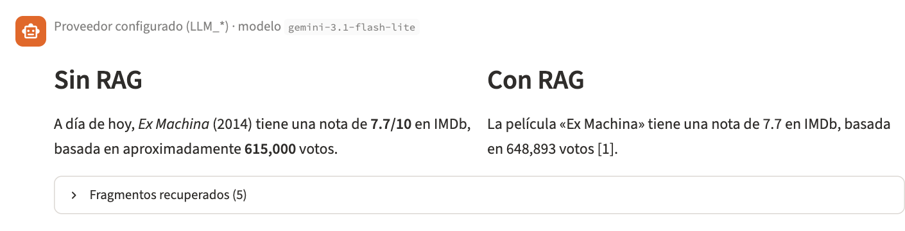

# Resumen del proyecto {.unnumbered}

Siguiendo con la temática anterior, el objetivo de este proyecto es construir y desplegar un sistema RAG completo especializado en dicho dominio. A partir de una base de conocimiento propia, el sistema busca demostrar de forma empírica su superioridad frente a un modelo de lenguaje (LLM) base sin contexto externo, logrando mitigar las alucinaciones y aportar información especializada, precisa y fundamentada sobre el género y sus temáticas.

::: {.callout-note title="🔗 Enlaces del proyecto"}
- **App desplegada (Streamlit):** <https://rtdgrag.streamlit.app/>
- **Repositorio GitHub:** <https://github.com/William-glj/RAG>
- **Diapositivas de la exposición:** [diapositivas.html](diapositivas.html)
:::

# Introducción y Objetivos

## Temática y subtema

- **Tema general:** Cine 🎬
- **Subtema:** *El cine de ciencia ficción y los miedos a la innovación y los avances tecnológicos*
- **Foco concreto:** la **inteligencia artificial** como manifestación actual de ese miedo.

Este proyecto construye y despliega un sistema RAG especializado en **cine de ciencia ficción**, centrado en cómo el cine representa los **miedos sociales ante la innovación y los avances tecnológicos**, con la **inteligencia artificial** como foco. A partir de un **corpus enriquecido**, para demostrar mediante que el sistema con RAG **reduce alucinaciones** y **aporta información especializada** frente a un LLM sin contexto.

### Mitigar alucinaciones

Mecanismo de control que fuerza al LLM a responder basándose únicamente en evidencia recuperada.

Mecanismo: Anclaje estricto (grounding) de cada respuesta en fragmentos documentales verificables recuperados antes de generar texto

### Aportar información especializada y actualizada

Inyección dinámica de conocimiento específico de dominio y análisis recientes no presentes en el preentrenamiento.

Cubre lagunas que no existen (o están desactualizadas) en los pesos preentrenados del modelo base.

## ¿Qué información recopilamos y por qué?

Un corpus debe cumplir **dos requisitos**:

- **Enriquecido** → variedad de fuentes (prensa, crítica, ámbito académico, público), de tipos de texto y de perspectivas (alarmistas, éticas, críticas). Así los textos **no dicen todos lo mismo**.

- **Específico** → todos los textos giran en torno al **miedo a la innovación y a los avances tecnológicos**, sin dispersarse en otros tópicos de la ciencia ficción.


## Planificación al corpus real

Las listas de "qué recopilar" se convirtieron en el corpus real. La planificación cubría **dos ramas**:

1. **IA** (autómatas de *Metrópolis*, HAL 9000, *Blade Runner*, *Ex Machina*, *Her*, *Terminator*…)
2. **Miedos y evolución** (deshumanización industrial, complejo de Frankenstein, biotecnología, vigilancia…)

# Fases del Proyecto
## Fase A: Captación Automatizada de Datos (Data Pipeline)

| Orden | Script | Función en el pipeline |
| :---: | :--- | :--- |
| **1** | `cargar_datos.py` | Descargar IMDb y  API de TMDB. |
| **2** | `scraping_criticas.py` | Extraer información. |
| **3** | `limpiar_datos.py` | Limpieza en `./datosDescargados/limpio`. |

: Scripts de automatización {.table-bordered .table-hover tbl-colwidths="[10,30,60]"}

**Datos estructurados, no estructurados y semi-estructurados**
La captación produce **tres tipos de datos** según su formato:

| Tipo | Procedencia | 
|---|---|
| **Estructurados** | IMDb (datasets `title.basics.tsv.gz`, `title.ratings.tsv.gz`) y TMDB (API v3: metadatos y ratings) | 
| **No estructurados** | Críticas web, PDFs académicos y transcripciones de vídeo | 

- **Estructurados:** filas × columnas con esquema fijo (título, año, géneros, nota, votos…). Cada fila es una película.
- **No estructurados:** texto libre sin esquema (crítica, artículo, tesis, transcripción), que se troceará e indexará para la recuperación.

### `cargar_datos.py`: IMDb (datasets oficiales) y robustez de la ingesta

`cargar_datos.py` descarga y cruza las **dos fuentes estructuradas** del corpus:

- **IMDb** → datasets oficiales (`title.basics.tsv.gz` + `title.ratings.tsv.gz`): metadatos (título, año, géneros, duración) y ratings (nota media y nº de votos).
- **TMDB** → API v3: sinopsis, keywords, nota y **reseñas de usuarios** (detalle en 2.1.2).

Ambas se enlazan por `imdb_id` en `cruceIMDBTMDB.csv`, y junto a `imdb_peliculas.csv`, `tmdb_peliculas.csv` y `tmdb_reviews.csv` forman los cuatro ficheros de salida.

**Primer filtro de especificidad (IMDb):**

```python
# cargar_datos.py · cargar_basics()
mascara = (
    (df["titleType"] == "movie")            # solo películas
    & df["genres"].str.contains("Sci-Fi")   # género ciencia ficción
    & (df["isAdult"] == "0")                # excluye contenido adulto
)
df = df.loc[mascara]
```

De los millones de títulos de IMDb, este filtro conserva únicamente las **películas de ciencia ficción** (16 759 filas).

**Robustez de la descarga (`descargar_archivo()`):**

```python
# cargar_datos.py · descargar_archivo()
if destino.exists():                    # idempotencia: no se re-descarga
    return destino
with requests.get(url, stream=True) as r:
    for bloque in r.iter_content(chunk_size=1024*1024):
        f.write(bloque)                 # streaming + barra de progreso tqdm
```

**`cargar_datos.py`: TMDB (API v3)**
```python
# cargar_datos.py · tmdb_get()  (líneas ~339–355)
for intento in range(reintentos):
    r = session.get(url, params=params, timeout=30)
    if r.status_code == 200:
        time.sleep(TMDB_PAUSA)        # respeta el rate-limit (~4 req/s)
        return r.json()
    if r.status_code in (429, 500, 502, 503, 504) and intento < reintentos - 1:
        time.sleep(2 ** intento)      # backoff exponencial
        continue
    r.raise_for_status()
```

**Fuentes del enunciado que cubre `cargar_datos.py` (2 de 4):**

El enunciado permite **4 tipos de fuentes**; este script cubre **2 de ellas**:

| Tipo (enunciado) | Qué usamos |
|---|---|
| Datasets estructurados | IMDb datasets oficiales (`title.basics.tsv.gz`, `title.ratings.tsv.gz`) |
| APIs públicas | TMDB API v3 (metadatos, sinopsis, keywords y **reseñas**) |

### `scraping_criticas.py`: extracción web, PDFs y transcripción de vídeo

`scraping_criticas.py` lee la lista de enlaces (`TARGETS`) y, de cada página, extrae **únicamente el texto** de la crítica o artículo, guardándolo en un `.txt` con cabecera de procedencia. Genera **22 documentos de texto libre**: 15 críticas web + 3 PDF académicos (vía `TARGETS`) y 4 transcripciones de YouTube (vía `VIDEOS`).

Cada entrada de `TARGETS` es una tupla `(nombre, fuente, url, extractor)`:

```python
# scraping_criticas.py · TARGETS  (cada fila = un documento del corpus)
("Blade Runner 2049 - la apoteosis de lo humano (CinemaNet)",
 "CinemaNet",
 "https://www.cinemanet.info/2018/01/analisis-blade-runner-2049-...",
 "cinemanet"),
```

**Un extractor por sitio** (cada web tiene un HTML distinto):

```python
EXTRACTORES = {
    "espinof": extraer_espinof, "sensacine": extraer_sensacine,
    "lavanguardia": extraer_lavanguardia, "rogerebert": extraer_rogerebert,
    "blogspot": extraer_blogspot, "theconversation": extraer_theconversation,
    "cinemanet": extraer_cinemanet, "wordpress": extraer_wordpress,
}
```

Cada extractor localiza el contenedor del artículo con selectores CSS (`select_one`) y extrae los párrafos con BeautifulSoup. Los PDFs se procesan con `extraer_pdf()` (`pypdf`) y los vídeos con `transcribir_video()` (`yt-dlp`).

**Robustez del scraping:**

```python
# scraping_criticas.py · _get()  (reintentos ante 429/5xx)
for intento in range(reintentos):
    r = requests.get(url, headers=HEADERS, timeout=timeout)
    if r.status_code == 200:
        return r
    if r.status_code in (429, 500, 502, 503, 504) and intento < reintentos - 1:
        time.sleep(3 * (intento + 1))   # espera creciente
        continue
    r.raise_for_status()
```

**Documentos que genera `scraping_criticas.py` (22 textos):**

Este script cubre las otras **2 de las 4 fuentes** del enunciado —*extracción web (scraping)* y *documentos no estructurados (PDF)*—, más **4 transcripciones de vídeo**. Lista completa:

| # | Documento | Tipo de fuente | Eje temático |
|---|---|---|---|
| 1 | *2001: Una odisea del espacio* — crítica (Espinof) | Crítica cinematográfica | IA (HAL 9000) |
| 2 | *2001* — opiniones de espectadores (SensaCine) | Opinión del público | IA |
| 3 | *2001* — tesis (Repositorio UACM, PDF) | Investigación académica | Cibernética / máquina |
| 4 | *El miedo a la tecnología, de la escritura al 5G* (La Vanguardia) | Periodismo divulgativo | Miedos históricos a la tecnología |
| 5 | *Ex Machina* — crítica (Roger Ebert) | Crítica | IA / relación humano-máquina |
| 6 | *Upgrade* — crítica (El Cuervo Enteradillo) | Crítica (blog) | IA / cuerpo aumentado |
| 7 | *IA y cine: dilemas éticos* (TFG UCM, PDF) | Investigación académica | Ética: *Metrópolis*, *2001*, *Blade Runner* |
| 8 | *El futuro de la robótica en las distopías* (The Conversation) | Prensa académica | Robótica y distopías |
| 9 | *Blade Runner* — análisis (CinemaNet) | Análisis filosófico | Replicantes / miedo a la muerte |
| 10 | *Blade Runner 2049* — análisis (CinemaNet) | Análisis filosófico | Transhumanismo / posthumanismo |
| 11 | *2001* — crítica (Cine y Psicología) | Crítica (blog) | IA (HAL 9000) |
| 12 | *Ex Machina* — crítica (El Antepenúltimo Mohicano) | Crítica (blog) | IA / relación humano-máquina |
| 13 | *Ex Machina* — crítica (Cinéfilos Frustrados) | Crítica | IA / relación humano-máquina |
| 14 | *Her* — crítica (El Antepenúltimo Mohicano) | Crítica (blog) | IA / soledad |
| 15 | *Her* — análisis académico (Repositorio UOC, PDF) | Investigación académica | Soledad posmoderna / IA |
| 16 | *Upgrade* — crítica (El Contraplano) | Crítica | IA / cuerpo aumentado |
| 17 | *Upgrade* — implantes de IA (Cinemas Comics) | Crítica | IA / implantes |
| 18 | *Blade Runner* — análisis filosófico (Proyecto Scio UCV) | Análisis filosófico | Replicantes / filosofía |
| 19 | *¿Por qué le tenemos miedo a la tecnología?* (YouTube, transcrito) | Vídeo divulgativo | Miedo a la tecnología |
| 20 | *Upgrade* — vídeo sobre implantes de IA (YouTube, transcrito) | Vídeo divulgativo | IA / implantes |
| 21 | Vídeo extra 2 — miedo a la tecnología (YouTube, transcrito) | Vídeo divulgativo | Miedo a la tecnología |
| 22 | Vídeo extra 3 — miedo a la tecnología (YouTube, transcrito) | Vídeo divulgativo | Miedo a la tecnología |

### `limpiar_datos.py`: limpieza y normalización del corpus

`limpiar_datos.py` lee lo que generan los dos scripts anteriores y produce la versión limpia en `./datosDescargados/limpio`, aplicando **cinco reglas**: descarta nulos y duplicados, conserva **solo** las películas con texto recuperable, prioriza `relevante_ia` y limpia el texto de las críticas (pies de página, portadas, números de página).

**Segundo filtro de especificidad** (sobre el cruce IMDb↔TMDB):

```python
# limpiar_datos.py · limpiar_csvs()
tiene_nota = cruce["rating_imdb"].notna() | cruce["rating_tmdb"].notna()
has_review = (cruce["imdb_id"].isin(review_imdb_ids)
              | cruce["imdb_id"].isin(set(scraped_count)))
conservar  = tiene_nota & has_review   # SOLO películas con reseña de texto
master     = cruce.loc[conservar]
```

**Limpieza del texto** (críticas y PDFs):

- `_BOILERPLATE`: regex que eliminan pies de página, suscripciones, "te puede interesar", avisos legales…
- `_limpiar_cuerpo_pdf` / `_limpiar_cuerpo_pdf_ucm`: quitan portada, índice (TOC), números de página y reúnen los párrafos cortados por la extracción de `pypdf`.
- `normalizar_espacios()` y `sin_acentos()`: colapsan espacios/saltos y permiten comparaciones robustas.

::: {.callout-important title="🎯 Robustez a explicar en la defensa"}
- **Precisión sobre volumen:** de 16 813 registros del cruce se conservan solo **59** (los que tienen reseña de texto). Las películas que solo aportan metadatos no nutren al RAG y se descartan.
- **Reseñas de ruido:** se descartan las vacías o menores de 80 caracteres ("Awesome!") y las duplicadas.
- **Relevancia IA:** `relevante_ia` se resuelve primero desde las keywords de TMDB y, si no, por heurística sobre título/géneros.
- **Trazabilidad:** se genera `criticas_manifest.csv` (metadatos de cada crítica) y `resumen_limpieza.txt` (antes/después).
:::

## Resultados del pipeline (números reales)

| Dato | Antes | Después |
|---|---|---|
| IMDb películas (Sci-Fi) | 16 759 | **46** con reseña |
| TMDB películas | 177 | **59** |
| TMDB reseñas | 484 | **460** |
| Cruce IMDb↔TMDB | 16 813 | **59** |
| Críticas/análisis scrapeados | 22 | **22** (688 339 caracteres) |

- **59 películas** con reseña de texto, **todas relevantes a IA/tecnología**.
- **~1 293 692 caracteres** de texto recuperable total (reseñas + críticas + sinopsis).

::: {.callout-note title="💡 Cómo usarlos en la defensa"}
Estos números salen de `datosDescargados/limpio/resumen_limpieza.txt` y demuestran el **filtro de precisión** del pipeline: no se acumula volumen, se conserva solo lo que tiene texto y está en el tema. Es la base de la "robustez de la automatización en la ingesta".
:::


## Fase B: Arquitectura RAG y Estrategia de Chunking

### Librería de orquestación: LangChain

Elegimos **LangChain** porque proporciona exactamente las piezas que un RAG necesita, y encajan entre sí:

- El tipo **`Document`** (`page_content` + `metadata`) para representar cada texto con su procedencia.
- El splitter **`RecursiveCharacterTextSplitter`** para el troceado.
- La integración **`langchain-chroma`** con la base vectorial.
- La interfaz común **`Embeddings`**, sobre la que construimos `EmbeddingsE5`.

Así, todo el pipeline de la Fase B se reduce a una cadena legible y repetible: `Document → trocear → embed → indexar`.

### Base de datos vectorial: ChromaDB

Elegimos **ChromaDB** por cuatro motivos:

1. **Persistencia en disco** (`persist_directory`): no hace falta levantar un servidor; el índice vive en `indice_chroma/`.
2. **Filtros de metadatos nativos** (`filter`): los usamos para filtrar por tipo de documento y por relevancia a IA.
3. **Integración con LangChain** (`langchain-chroma`).
4. **Código abierto y ligero**: el corpus (~1.400 fragmentos) cabe holgadamente.

### Modelo de embeddings: `intfloat/multilingual-e5-small`

El corpus mezcla **español** (críticas, tesis, artículos) e **inglés** (reseñas de TMDB, Roger Ebert), por lo que el modelo debe ser **multilingüe**. Elegimos `multilingual-e5-small` (384 dimensiones) y **descartamos** `paraphrase-multilingual-MiniLM-L12-v2` porque trunca cada texto a 128 tokens (~500 caracteres): con fragmentos de 1.500 caracteres, la mitad del fragmento quedaría fuera del embedding.

Los modelos **E5** exigen un prefijo que distingue los dos usos: `"passage: "` al indexar y `"query: "` al consultar. Nuestra clase `EmbeddingsE5` los añade automáticamente:

```python
# rag_comun.py · EmbeddingsE5
def embed_documents(self, texts):
    textos = [self.prefijo_documento + t for t in texts]   # "passage: "
    return self.modelo.encode(textos, normalize_embeddings=True)

def embed_query(self, text):
    return self.modelo.encode(self.prefijo_consulta + text,  # "query: "
                              normalize_embeddings=True)
```

### Estrategia de chunking

Usamos **`RecursiveCharacterTextSplitter`** (chunking recursivo) con estos parámetros:

- **`chunk_size = 1500`** caracteres (~240 tokens de media, por debajo del límite de 512 tokens de E5).
- **`chunk_overlap = 225`** (15 %), para no cortar una idea a mitad.
- **Separadores** `["\n\n", "\n", ". ", " ", ""]`: corta primero por párrafo, luego por línea, luego por frase y por palabra. Respeta la estructura semántica (nunca parte una palabra).

Reglas específicas:

- Las **fichas de película no se trocean** (una ficha ya es la unidad mínima con sentido).
- Las **opiniones de espectadores se separan por autor antes de trocear** (cada espectador es un documento, para no mezclar opiniones).
- Se antepone a cada fragmento una **línea de contexto** (`[Crítica: … — fuente]`, `[Reseña de usuario de TMDB sobre …]`…) para que el embedding sepa de qué película/fuente habla aunque el trozo no la nombre.

```python
# construir_indice.py · trocear()
splitter = RecursiveCharacterTextSplitter(
    chunk_size=chunk_size, chunk_overlap=chunk_overlap,
    separators=["\n\n", "\n", ". ", " ", ""], keep_separator="end",
    length_function=len,
)
```

### ¿Cómo afecta el tamaño del chunk a la recuperación?

- **Chunks pequeños** → búsqueda más precisa, pero menos contexto: una idea puede quedar repartida en varios fragmentos.
- **Chunks grandes** → más contexto por fragmento, pero diluyen la señal semántica (el embedding mezcla varias ideas) y pueden superar el límite de tokens del modelo.

Lo **validamos empíricamente** con `comparar_chunking.py`, que reconstruye el índice con tres tamaños y lanza las mismas preguntas de prueba midiendo `acierto@5` y **MRR** (la posición media del primer acierto):

| Tamaño | Solape | Fragmentos | Long. media | acierto@5 | MRR |
|---|---|---|---|---|---|
| 500 | 75 | 3.733 | 437 | **0.929** | 0.768 |
| 1.000 | 150 | 1.919 | 789 | 0.714 | 0.679 |
| **1.500** | **225** | **1.387** | **1.068** | 0.857 | **0.774** |

**Conclusión:** el tamaño de 500 obtiene el mayor `acierto@5` (13/14), pero genera **3.733 fragmentos** (casi el triple) de solo ~437 caracteres, que pierden contexto. El tamaño de **1.500** ofrece el **mejor MRR** (0.774, encuentra antes el fragmento correcto), recupera 12/14 con fragmentos mucho más ricos (~1.068 caracteres de media) y un índice 2,7× más pequeño. Elegimos **1.500** por ese equilibrio entre tasa de acierto, contexto por fragmento y eficiencia del índice.

*Nota metodológica: la métrica `acierto@5` es orientativa — comprueba que una palabra clave aparezca en el fragmento recuperado, no que la respuesta sea correcta. La calidad real de la recuperación se valida con el LLM en la Fase C.*

### Indexado

`construir_indice.py` borra el índice anterior y lo reconstruye desde cero (proceso **repetible**), insertando en lotes:

```python
# construir_indice.py · construir()
_borrar_indice(indice_dir)                 # índice anterior fuera
base = abrir_base(indice_dir, embeddings)  # Chroma con espacio coseno
for i in range(0, len(fragmentos), cfg.LOTE_CHROMA):
    lote = fragmentos[i:i + cfg.LOTE_CHROMA]
    base.add_documents(lote, ids=[f.metadata["chunk_id"] for f in lote])
```

## Fase C: Evaluación Comparativa (Sin RAG vs Con RAG)

### Banco de pruebas

Definimos **14 preguntas** en `config_rag.py`: **8 factuales** (HAL 9000, nota de Ex Machina, opiniones de SensaCine, películas sobre IA…) y **6 analíticas** (¿somos reemplazables?, humano vs máquina, límites del avance tecnológico…). Son preguntas de nicho sobre **este corpus concreto**, que un LLM genérico no puede responder con precisión sin los documentos.

### Metodología

Las mismas preguntas se lanzan en la app en modo **"Comparar ambos"**: el **mismo modelo** (`gemini-3.1-flash-lite`) responde primero sin contexto y después con los `k = 5` fragmentos recuperados de ChromaDB. Así la única diferencia entre las dos respuestas es el RAG.

Presentamos **dos pruebas** representativas, ejecutadas en la app desplegada (capturas reales):

### Prueba 1 · Dato factual: nota y votos de *Ex Machina* en IMDb

{fig-align="center" width="100%"}

| | Sin RAG | Con RAG |
|---|---|---|
| Nota IMDb | 7.7 | 7.7 |
| Nº de votos | "aproximadamente **615.000**" ❌ (inventado) | **648.893** ✅ citando el fragmento [1] |
| Año | 2014 | 2015 (año de la ficha de IMDb/TMDB del corpus) |

- **Sin RAG**, el modelo *acierta la nota* (dato muy conocido) pero **alucina el número de votos**, y lo dice con total seguridad ("a día de hoy").
- **Con RAG**, el recuperador encuentra la **ficha de la película** (tipo `ficha`, distancia coseno 0.119, la más cercana) generada por nuestro pipeline a partir de los datasets de IMDb, y el modelo copia el dato exacto citando la fuente.

{fig-align="center" width="85%"}

### Prueba 2 · Conocimiento de nicho: opiniones de SensaCine sobre *2001*

{fig-align="center" width="100%"}

- **Sin RAG**: se inventa una **"nota media de 4.2 sobre 5"** y describe dos posturas genéricas ("los entusiastas" / "los críticos") que podrían valer para cualquier clásico. No cita ninguna opinión concreta: es **plausible pero no verificable**.
- **Con RAG**: los 5 fragmentos recuperados son opiniones reales de espectadores de SensaCine (tipo `opinion_espectadores`, separadas por autor en el chunking). La respuesta cita expresiones literales ("obra maestra", "clase magistral de cine", "una de las películas más sobrevaloradas de la historia", "petardo") e indica en cada afirmación de qué fragmento sale ([1], [2], [5]…).

### Control de alucinaciones fuera del dominio

Si se pregunta algo que **no está en el corpus** (por ejemplo, *"¿Cuántos Óscar ganó Oppenheimer y quién compuso su banda sonora?"*), el modo Con RAG responde **"No hay información suficiente en la base de datos."** en lugar de inventar, porque el prompt de sistema le obliga a usar solo los fragmentos:

```python
# con_rag.py · prompt de sistema
SISTEMA = (
    "Eres un asistente especializado en cine de ciencia ficción. Responde en español "
    "usando EXCLUSIVAMENTE la información de los fragmentos proporcionados. Cita entre "
    "corchetes los fragmentos que uses, por ejemplo [2]. Si la respuesta no aparece en "
    "los fragmentos, responde: 'No hay información suficiente en la base de datos.'"
)
```

### Conclusión de la evaluación

| Criterio | Sin RAG | Con RAG |
|---|---|---|
| Datos concretos (votos, notas) | Aproximados o inventados | Exactos, del corpus |
| Trazabilidad | Ninguna | Cita de fragmentos `[n]` + fuente visible en la app |
| Pregunta fuera del corpus | Responde igualmente (riesgo de alucinar) | Reconoce que no lo sabe |

El banco completo de 14 preguntas (`config_rag.py`) puede regenerarse con `sin_rag.py` y `con_rag.py`, que guardan los resultados en `resultados_llm/`.

## Fase D: Interfaz de Usuario y Despliegue

### Aplicación web (Streamlit)

`app.py` ofrece una interfaz en tiempo real con:

- **Selector de proveedor** (configurado por `LLM_*` u OpenRouter).
- **Tres modos:** *Con RAG*, *Sin RAG* y *Comparar ambos* (respuestas lado a lado).
- **Parámetros:** número de fragmentos `k`, filtro por tipo de documento y filtro "solo películas relevantes a IA".
- **Trazabilidad:** cada respuesta con RAG muestra los fragmentos usados, con fuente y distancia.

Los recursos pesados (modelo de embeddings e índice) se cargan una sola vez con `@st.cache_resource`:

```python
# app.py
@st.cache_resource(show_spinner="Cargando el modelo de embeddings y el índice...")
def obtener_base():
    return abrir_base(cfg.INDICE_DIR, EmbeddingsE5())
```

{fig-align="center" width="100%"}

### Despliegue público

La app está desplegada en **Streamlit Community Cloud** → <https://rtdgrag.streamlit.app/>. La plataforma lee el repositorio de GitHub e instala `requirements.txt`. Las claves se inyectan como **secretos** (`st.secrets`, formato TOML) y `cargar_secretos()` las copia al entorno para que `llm_comun.py` las lea igual que desde el `.env` local.

::: {.callout-important title="🔑 Nota sobre Hugging Face Spaces"}
Inicialmente se consideró HF Spaces, pero desde 2025 los Spaces con SDK Docker/Gradio requieren plan de pago para cuentas nuevas. Por eso el despliegue final es en Streamlit Community Cloud (gratis).
:::

::: {.callout-warning title="⏰ Apps dormidas"}
Streamlit Community Cloud **duerme las apps tras unos días sin visitas**. Al abrirla aparece *"This app has gone to sleep"*: se pulsa **"Yes, get this app back up!"** y en ~1–2 minutos vuelve a estar disponible (el índice ChromaDB está versionado en el repositorio, así que no hay que reconstruirlo).
:::

## Fase E: Técnicas Avanzadas de RAG (Opcional)

### Implementado: filtros de metadatos

Antes de la búsqueda vectorial se puede filtrar por **tipo de documento** (`critica`, `resena`, `academico`, `divulgacion`, `ficha`, `opinion_espectadores`) y por **relevancia a IA** (`relevante_ia`), mediante el filtro de metadatos de Chroma:

```python
# rag_comun.py · construir_filtro()
def construir_filtro(tipo=None, solo_relevantes_ia=False):
    condiciones = []
    if tipo:
        condiciones.append({"tipo": tipo})
    if solo_relevantes_ia:
        condiciones.append({"relevante_ia": True})
    if len(condiciones) == 1:
        return condiciones[0]
    return {"$and": condiciones}
```

Esto permite preguntas como *"miedo a la IA"* restringidas a `resena` o solo a películas marcadas como relevantes, refinando la recuperación antes de llamar al LLM.

### No implementado (posible trabajo futuro)

- **Reranking** (p. ej. FlashRank): reordenar los fragmentos recuperados con un modelo de relevancia antes de dárselos al LLM.
- **Hybrid search (BM25 + vectorial)**: combinar búsqueda léxica y semántica para términos exactos (p. ej. nombres propios, notas).

Ambos se documentan como posibles extensiones; el **filtro de metadatos** ya cubre la puntuación extra de la Fase E.

# Documentación y Entrega (Quarto y GitHub)

### Estructura del repositorio

El código está en el repositorio de GitHub con esta organización:

| Script | Fase |
|---|---|
| `cargar_datos.py`, `scraping_criticas.py`, `limpiar_datos.py` | A. Captación y limpieza |
| `construir_indice.py`, `comparar_chunking.py`, `probar_recuperacion.py`, `rag_comun.py`, `config_rag.py` | B. RAG y chunking |
| `sin_rag.py`, `con_rag.py`, `llm_comun.py` | C. Evaluación |
| `app.py` | D. Interfaz y despliegue |
| `requirements.txt` | Dependencias |

### Web Quarto

Esta misma memoria (generada con Quarto) cubre: motivación y procedencia de los datos, pipeline de automatización, estrategia de chunking, evaluación comparativa, enlaces y extractos de código.

### Publicación online

La memoria y las diapositivas forman un pequeño sitio Quarto (`_quarto.yml`) que se publica en **GitHub Pages** desde la rama `gh-pages`:

```bash
quarto render            # genera _site/ (memoria + diapositivas)
quarto publish gh-pages  # sube _site/ a la rama gh-pages
```

# Exposición y Criterios de Evaluación

- **Fecha:** 27 de noviembre.
- **Reparto de roles** (uno por miembro):
  - Captación y pipeline de datos (Fase A) → **Guillermo**
  - Vector DB, chunking y librerías (Fase B) → **Tomas**
  - Interfaz y despliegue (Fase D) → **Dylan**
  - Evaluación comparativa y técnicas avanzadas (Fases C y E) → **Jose Ramon**
- **Criterios a cubrir:** automatización robusta, fundamentación técnica, claridad de la comparativa, calidad de la interfaz, documentación y dominio individual.

# Enlaces {.unnumbered}

- **Repositorio GitHub** → https://github.com/William-glj/RAG
- **App desplegada (Streamlit)** → <https://rtdgrag.streamlit.app/>
- **Web Quarto** → <https://william-glj.github.io/RAG/>
- **Diapositivas** → <https://william-glj.github.io/RAG/diapositivas.html>
